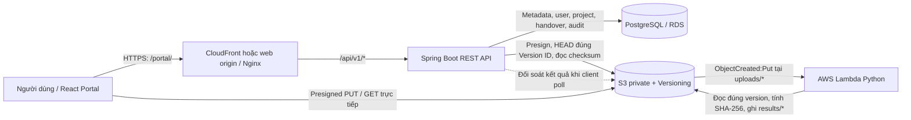

# Cloud Document Handover

**Hệ thống quản lý, lưu trữ, kiểm tra tính toàn vẹn và bàn giao tài liệu trên AWS — Đồ án Nhóm 5**

Cloud Document Handover là ứng dụng web dành cho nhóm làm việc nhỏ: quản lý dự án và thành viên, tải lên các phiên bản tài liệu, xác minh nội dung bằng SHA-256, tạo gói bàn giao có người nhận và theo dõi việc phát hành/xác nhận/thu hồi. Hệ thống sử dụng **React + Spring Boot + PostgreSQL**, kết hợp **Amazon S3, AWS Lambda và Elastic Beanstalk** cho kiến trúc triển khai trên đám mây.

> **Trạng thái nguồn (13/11/2026):** Nhánh `main` chứa mã nguồn tích hợp của frontend, backend, hợp đồng API, Lambda, hạ tầng và bộ kiểm thử. Có các bằng chứng kiểm thử local/offline trong repository. Việc có mã nguồn/CloudFormation **không đồng nghĩa** tính năng đã vượt qua kiểm thử end-to-end trên AWS thật. Tình trạng triển khai trực tuyến phải đối chiếu riêng bằng Elastic Beanstalk, RDS, S3, Lambda, log và kết quả kiểm thử của đúng phiên bản đang chạy; một số báo cáo trong `docs/` là ảnh chụp lịch sử trước khi nhóm triển khai thủ công.

## Mục lục

1. [Tổng quan và phạm vi](#1-tổng-quan-và-phạm-vi)
2. [Chức năng và phân quyền](#2-chức-năng-và-phân-quyền)
3. [Kiến trúc hệ thống](#3-kiến-trúc-hệ-thống)
4. [Công nghệ sử dụng](#4-công-nghệ-sử-dụng)
5. [Cấu trúc repository](#5-cấu-trúc-repository)
6. [Chạy ứng dụng trên máy local](#6-chạy-ứng-dụng-trên-máy-local)
7. [Cấu hình môi trường](#7-cấu-hình-môi-trường)
8. [Quy trình nghiệp vụ và API](#8-quy-trình-nghiệp-vụ-và-api)
9. [Kiểm thử và bằng chứng](#9-kiểm-thử-và-bằng-chứng)
10. [Triển khai AWS và vận hành](#10-triển-khai-aws-và-vận-hành)
11. [Bảo mật, giới hạn và việc còn mở](#11-bảo-mật-giới-hạn-và-việc-còn-mở)
12. [Tài liệu chuyên sâu và thành viên](#12-tài-liệu-chuyên-sâu-và-thành-viên)

## 1. Tổng quan và phạm vi

### Bài toán

Khi nhiều thành viên cùng làm việc với tài liệu, việc gửi file rời rạc qua tin nhắn hoặc email dễ gây nhầm phiên bản, thiếu thông tin người nhận và không có bằng chứng xác nhận. Dự án tập trung giải quyết các vấn đề đó thông qua:

- **Phân quyền theo dự án:** thành viên chỉ truy cập những dự án/tài liệu mình được phép.
- **Quản lý phiên bản:** mỗi lần tải lên tạo một `FileVersion` riêng, không ghi đè lịch sử.
- **Xác minh toàn vẹn:** kiểm SHA-256 và đúng **S3 Version ID** trước khi tài liệu đủ điều kiện sử dụng.
- **Bàn giao có trạng thái:** ghi rõ tài liệu, người nhận, thời hạn và lịch sử xác nhận/thu hồi.
- **Khả năng vận hành:** tách metadata PostgreSQL khỏi nội dung file S3; có công cụ đóng gói, backup/restore, kiểm thử và theo dõi.

Ứng dụng hiện được xây dựng theo **modular monolith** ở backend Spring Boot, **không** phải hệ thống microservices. Thư mục `nextcloud/` là thành phần thử nghiệm/giai đoạn thiết kế cũ, **không** nằm trong luồng lưu trữ S3 chính của Portal.

## 2. Chức năng và phân quyền

| Nhóm chức năng | Những gì đã có trong mã nguồn | Ghi chú |
| --- | --- | --- |
| Tài khoản | Đăng ký, đăng nhập, xem thông tin tài khoản, đăng xuất; session và CSRF | Đăng ký không tự đăng nhập; chưa có xác minh email/reset mật khẩu |
| Dự án | Tạo, xem danh sách/chi tiết, xem thành viên, quản lý quyền | Có kiểm tra quyền ở backend; danh sách phân trang |
| Tài liệu | Tạo phiên upload, tải lên S3 qua presigned PUT, hoàn tất upload, xem phiên bản, lấy link tải | Tích hợp S3 phụ thuộc cấu hình AWS thực tế |
| Toàn vẹn file | SHA-256 phía trình duyệt, Lambda xử lý bản S3, backend đối soát kết quả | Phân biệt `VERIFIED`, `MISMATCH`, đang chờ và lỗi xử lý |
| Bàn giao | Tạo `DRAFT`, phát hành `READY`, người nhận xác nhận `CONFIRMED`, thu hồi | Gói ghim đúng phiên bản; lưu lịch sử/audit |
| Vận hành | Build artefact, kiểm thử nhiều tầng, backup/restore PostgreSQL với S3, CloudWatch templates | Bằng chứng local không thay thế nghiệm thu AWS |

**Quyền truy cập chính:**

| Vai trò | Khả năng |
| --- | --- |
| **Owner** | Tạo và quản lý dự án, thêm/đổi/gỡ Editor/Viewer, upload, lập/phát hành/thu hồi gói bàn giao |
| **Editor** | Làm việc với tài liệu và phiên bản của dự án theo quyền ghi |
| **Viewer** | Xem thông tin/tài liệu mà quyền dự án cho phép; không có quyền upload hoặc quản lý thành viên |
| **Người nhận gói** | Xem/xác nhận/tải nội dung của gói được chỉ định, kể cả khi không phải thành viên dự án; không mặc nhiên được xem toàn bộ dự án |

Quyền được kiểm tra bằng **membership hiện tại** và trạng thái tài nguyên ở backend, không tin quyền do client gửi lên. Thao tác nhạy cảm phải giữ đúng session/CSRF.

## 3. Kiến trúc hệ thống



Sơ đồ là kiến trúc tích hợp trong source. Việc CloudFront có nằm trên đường truy cập ở **môi trường AWS đang chạy** hay không cần kiểm tra cấu hình deployment thực tế; không suy ra từ việc template đã có trong repository.

### Thành phần và trách nhiệm

- **Frontend (`frontend/`):** React SPA; giao diện đăng nhập/đăng ký, dự án, thành viên, file, phiên bản và bàn giao. Vite proxy API khi chạy local; production dùng cùng origin, với giao diện ở `/portal/`.
- **Backend (`backend/`):** Spring Boot REST API, Spring Security session/CSRF, nghiệp vụ/quyền, PostgreSQL JDBC/Flyway và `StoragePort` kết nối S3.
- **Database:** PostgreSQL lưu user, membership, metadata file, trạng thái upload, gói bàn giao, người nhận và audit; **không lưu byte nội dung file**.
- **S3 + Lambda (`aws/`):** bucket private bật Versioning; Lambda xử lý sự kiện từ `uploads/`, tính hash, lưu JSON kết quả dưới `results/`. Backend là nơi quyết định VERIFIED/MISMATCH.
- **Infrastructure & Ops (`infra/`, `deploy/`, `ops/`):** CloudFormation, IAM, Nginx/Beanstalk, các công cụ build/deploy và backup/restore.

### Dữ liệu chính

Migration hiện có là [`V1__initial_schema.sql`](backend/src/main/resources/db/migration/V1__initial_schema.sql), bao gồm các nhóm bảng `app_users`, `projects`, `memberships`, `file_metadata`, `file_versions`, `upload_sessions`, `handovers`, `handover_items`, `handover_recipients` và `audit_events`. Khi đổi schema đã phát hành, cần tạo migration Flyway mới thay vì sửa lịch sử V1 tùy tiện.

## 4. Công nghệ sử dụng

| Lớp | Công nghệ |
| --- | --- |
| Frontend | React **19.3.1**, JavaScript, Vite **8.3.7**, HTML/CSS |
| Backend | Java **21** (target), Spring Boot **3.5.16**, Spring Security, Spring JDBC, Maven Wrapper |
| Database | PostgreSQL (đã thử với dòng **17**), Flyway |
| Cloud storage | Amazon S3 private, Versioning, presigned PUT/GET, AWS SDK for Java v2 |
| Xử lý nền | AWS Lambda (Python), JSON checksum contract v1 |
| Triển khai | Elastic Beanstalk Java SE / Amazon Linux 2023, Nginx, CloudFormation; có template CloudFront |
| Kiểm thử | JUnit/Spring Test, Node test runner, Playwright, Python `unittest`, LocalStack và Docker cho các bài riêng |
| Giám sát/vận hành | CloudWatch, công cụ backup/restore PostgreSQL ↔ S3, manifest SHA-256 |

Phiên bản thực tế của AWS platform, RDS minor/runtime và các dependency cần kiểm tra lại khi triển khai; bảng trên mô tả source được đưa vào `main`, không phải kết quả kiểm tra live của AWS.

## 5. Cấu trúc repository

```text
cloud-document-handover/
├── README.md                 # Tổng quan dự án (file này)
├── PRINCIPLE.MD             # Quy tắc phối hợp, review và merge
├── backend/                 # Spring Boot, migration, kiểm thử và runbook backend
├── frontend/                # React/Vite Portal, unit test, Playwright E2E
├── aws/                     # Lambda checksum, Python adapter và test
├── contracts/               # OpenAPI, JSON Schema, ví dụ payload và adapter contract
├── infra/                   # CloudFormation, IAM, LocalStack/Docker
├── deploy/                  # Build bundle, deploy/redeploy, cấu hình EB/Nginx
├── ops/                     # Backup/restore, kiểm tra hạ tầng, chi phí
├── docs/                    # Báo cáo, tài liệu tích hợp, security, checkpoint, UAT
├── evidence/                # Bằng chứng kiểm thử có gắn commit/thời điểm
├── nextcloud/               # Thử nghiệm local / hướng thiết kế lịch sử, không phải Portal S3
├── tools/                   # Bộ kiểm PRE_AWS tổng hợp
└── .github/workflows/       # PRE_AWS checks (không phải CI/CD deploy AWS)
```

Đọc chi tiết từng phần: [Backend](backend/README.md) · [Frontend](frontend/README.md) · [S3/Lambda](aws/README.md) · [Infrastructure](infra/README.md) · [Deployment](deploy/README.md) · [Operations](ops/README.md) · [API contracts](contracts/README.md).

## 6. Chạy ứng dụng trên máy local

### Yêu cầu

- Git; **JDK 21+** tương thích target Java 21; Maven Wrapper đi kèm (lần đầu cần dependency cache hoặc Internet).
- **PostgreSQL 17** hoặc bản tương thích, với **database Portal riêng**, không dùng DB Nextcloud hoặc DB có dữ liệu quan trọng.
- **Node.js >= 22.12.0**, npm; **Python 3** cho các công cụ kiểm thử/đóng gói.
- Docker, Chrome/Chromium và các dependencies bổ sung chỉ cần khi chạy bộ test tích hợp/LocalStack tương ứng.

Ví dụ dưới đây dành cho **Windows PowerShell**, chạy từ repo đã clone:

```powershell
git clone https://github.com/Chien2k5/cloud-document-handover.git
cd cloud-document-handover
```

### Bước 1 — Tạo PostgreSQL cho Portal

Trong `psql` với tài khoản quản trị PostgreSQL, tạo **role và database mới**, không dùng lại DB staging/production:

```sql
CREATE ROLE handover LOGIN;
\password handover
CREATE DATABASE handover OWNER handover;
```

Flyway sẽ tạo schema lúc backend khởi động. Lệnh `\password` của `psql` yêu cầu nhập mật khẩu tương tác, không cần lưu mật khẩu vào script hoặc Git.

### Bước 2 — Chạy backend

Mở terminal PowerShell thứ nhất, từ repository root:

```powershell
cd backend
$env:DB_URL='jdbc:postgresql://127.0.0.1:5432/handover'
$env:DB_USERNAME='handover'
$dbPassword = Read-Host 'PostgreSQL password' -AsSecureString
$env:DB_PASSWORD = [System.Net.NetworkCredential]::new('', $dbPassword).Password
$env:SPRING_PROFILES_ACTIVE='local'
$env:SERVER_PORT='8080'
.\mvnw.cmd spring-boot:run
```

Kiểm tra `http://127.0.0.1:8080/api/v1/health` (trả `UP` khi backend/DB sẵn sàng). Local profile cho phép cookie qua HTTP loopback; **không bật profile `local` trên AWS**.

**Tài khoản demo (tùy chọn):** trước khi chạy backend ở local, đặt `LOCAL_DEMO_PASSWORD` với mật khẩu tự chọn từ 12 ký tự và không quá 72 byte UTF-8. Khi đó code có thể seed các user `dung@example.test`, `editor@example.test`, `viewer@example.test`, `outsider@example.test` nếu chưa có. Không tồn tại mật khẩu demo mặc định; seed không reset mật khẩu của user đã tồn tại.

```powershell
$demoPassword = Read-Host 'Local demo password (optional)' -AsSecureString
$env:LOCAL_DEMO_PASSWORD = [System.Net.NetworkCredential]::new('', $demoPassword).Password
```

Có thể sử dụng chức năng **Đăng ký** trên frontend để tạo tài khoản mới thay cho demo seed; tài khoản mới cần tự đăng nhập sau khi đăng ký.

### Bước 3 — Chạy frontend

Mở **terminal thứ hai** từ repository root:

```powershell
cd frontend
npm ci
npm run dev
```

Mở **http://127.0.0.1:5173**. Vite chuyển các request `/api/v1` về backend `127.0.0.1:8080` qua proxy local. Khi cần, thay đích bằng `API_PROXY_TARGET` (xem [`frontend/.env.example`](frontend/.env.example)).

> **Lưu ý:** Mặc định `UPLOAD_S3_ENABLED=false`: auth, project và membership vẫn hoạt động với DB local, nhưng chức năng cần storage thật có thể trả `503 STORAGE_UNAVAILABLE`. Đây là hành vi fail-closed, **không phải lỗi giao diện**. Muốn thử upload end-to-end phải cấu hình bucket, IAM, S3 Versioning, CORS và Lambda thích hợp; không copy AWS key vào frontend.

### Bước 4 — Giả lập các thành phần cloud (tùy chọn)

```powershell
# Chạy từ repository root; yêu cầu Docker đang hoạt động
docker compose -f infra/local/compose.yml up -d
python infra/local/bootstrap_localstack.py
```

Đây là môi trường mô phỏng/kiểm thử riêng, không tự biến bộ backend ở bước 2 thành phiên AWS thật. Hướng dẫn: [`infra/README.md`](infra/README.md).

## 7. Cấu hình môi trường

| Biến | Thành phần | Ý nghĩa |
| --- | --- | --- |
| `DB_URL` | Backend | JDBC URL PostgreSQL Portal, bắt buộc |
| `DB_USERNAME`, `DB_PASSWORD` | Backend | Credential DB; cung cấp ngoài Git |
| `SPRING_PROFILES_ACTIVE` | Backend | `local` chỉ dùng trên máy dev |
| `SERVER_PORT` | Backend | Cổng HTTP; local mặc định `8080`, EB cấu hình `5000` |
| `SESSION_COOKIE_SECURE` | Backend | Mặc định `true`; local profile cho phép `false` trên HTTP loopback |
| `LOCAL_DEMO_PASSWORD` | Backend | Seed tài khoản demo tùy chọn **chỉ ở local** |
| `UPLOAD_S3_ENABLED` | Backend | Mặc định `false`; bật khi storage AWS đã sẵn sàng |
| `UPLOAD_BUCKET` | Backend/Lambda | Tên bucket thực, cùng bucket cho luồng upload/checksum |
| `AWS_REGION` | Backend | Region S3/SDK thực tế |
| `UPLOAD_TTL_SECONDS` | Backend | Thời hạn phiên upload, mặc định `300` giây |
| `PROJECT_QUOTA_BYTES` | Backend | Hạn mức dự án theo metadata, mặc định `1 GiB` |
| `API_PROXY_TARGET` | Vite dev | Đích proxy API khi phát triển, không dùng trong bundle production |

Xem [`backend/.env.example`](backend/.env.example), [`frontend/.env.example`](frontend/.env.example) và [`aws/lambda/.env.example`](aws/lambda/.env.example). **Spring Boot và Lambda không tự đọc `.env`**; cần truyền env qua terminal, IDE hoặc cấu hình môi trường tương ứng. Không commit mật khẩu, access key, session cookie, presigned URL hay dữ liệu thật; không đặt secret trong `VITE_*` vì có thể xuất hiện ở bundle trình duyệt.

## 8. Quy trình nghiệp vụ và API

### 8.1. Luồng upload và xác minh

1. Owner/Editor chọn file; trình duyệt tính **SHA-256 của byte file**.
2. Backend tạo `upload_session`, giữ quota và trả thông tin **presigned PUT** cùng các header bắt buộc.
3. Trình duyệt PUT trực tiếp vào S3, cần lấy đúng **`x-amz-version-id`**. Không đưa session cookie/CSRF sang S3.
4. Trình duyệt gọi API `complete` bằng **Version ID vừa nhận**, không đoán theo ETag hoặc version mới nhất.
5. S3 phát sự kiện tạo object tại `uploads/`; Lambda đọc **đúng version**, tính SHA-256 và ghi kết quả JSON theo schema v1 vào `results/`.
6. Khi frontend polling API, backend đọc và đối soát identity/version/size/hash; chỉ phiên bản **AVAILABLE + VERIFIED** mới đủ điều kiện tải/bàn giao.

Lambda bất đồng bộ nên thành công của PUT **không đồng nghĩa** checksum đã hoàn tất. Có thể có trạng thái đang chờ, `MISMATCH`, lỗi xử lý hoặc lỗi hạ tầng. Khách hàng không nên tự động PUT lại khi mất response/Version ID để tránh tạo version không kiểm soát.

### 8.2. Luồng bàn giao

```text
Chọn FileVersion AVAILABLE + VERIFIED
          |
          v
Tạo gói DRAFT (title, các file version, UUID người nhận, expiry)
          |
          v
Owner phát hành -> READY
          |
          v
Người nhận mở gói và xác nhận (từng người)
          |
          v
Trạng thái tổng CONFIRMED khi đủ điều kiện
```

Gói lưu **đúng FileVersion/S3 Version ID** chứ không tự chuyển sang bản file mới. Owner có thể thu hồi quyền truy cập mới; bản ghi lịch sử/audit vẫn giữ. **Link presigned GET đã phát hành trước khi thu hồi có thể còn hiệu lực tới lúc hết TTL**, không phải thu hồi tức thì ở S3.

### 8.3. Các nhóm REST API

API sử dụng prefix **`/api/v1`**. Hợp đồng đầy đủ (method, schema, status/error): [`contracts/openapi.yaml`](contracts/openapi.yaml), phiên bản `0.5.0-backend-integration`.

| Nhóm | Endpoint tiêu biểu | Chức năng |
| --- | --- | --- |
| Health | `GET /health` | Kiểm tra kết nối DB/readiness |
| Auth | `GET /auth/csrf`, `POST /auth/login`, `GET /auth/me`, `POST /auth/logout`, `POST /auth/register` | Session và tài khoản |
| Project | `POST /projects`, `GET /projects`, `GET /projects/{id}` | Quản lý dự án |
| Membership | `GET /projects/{id}/members`, `PUT/DELETE /projects/{id}/members/{userId}` | Quản lý thành viên |
| Upload | `POST /projects/{id}/files/uploads`, `POST /projects/{id}/files/uploads/{uploadId}/complete`, `GET /projects/{id}/files/uploads/{uploadId}` | Upload theo phiên |
| File | `GET /projects/{id}/files`, `GET /projects/{id}/files/{fileVersionId}/download` | Phiên bản và tải file |
| Handover | `POST /projects/{id}/handovers`, `GET /handovers/{handoverId}`, `POST /handovers/{handoverId}/publish`, `/confirm`, `/revoke` | Chu trình bàn giao |
| Handover download | `GET /handovers/{handoverId}/items/{fileVersionId}/download` | Lấy link đúng version trong gói |

**Quy tắc xác thực:** login nhận `application/x-www-form-urlencoded`; đăng ký và API nghiệp vụ nhận JSON tương ứng. Trước request ghi cần lấy CSRF token từ `/auth/csrf`, giữ cookie cùng session và **lấy token mới sau khi login/logout**. Không gửi lại tự động request ghi khi không chắc server đã xử lý hay chưa.

## 9. Kiểm thử và bằng chứng

Repository phân biệt rõ **unit/mock**, **PostgreSQL thật trên local**, **browser với fixture**, **LocalStack** và **AWS thật**. Một bộ kiểm thử pass ở tầng này **không được coi** là pass ở tầng khác.

### Lệnh phổ biến

```powershell
# Backend: build + test cơ bản (integration PostgreSQL có thể bị SKIPPED)
cd backend
.\mvnw.cmd -B -ntp verify
cd ..

# Frontend: lint, unit, build và browser fixture
cd frontend
npm ci
npm run lint
npm test
npm run build
npm run test:e2e
cd ..

# Lambda/adapter Python: offline
python -m unittest discover -s aws/tests -v

# Tích hợp PRE_AWS: yêu cầu toolchain, Docker/browser và dữ liệu thử riêng
python tools/run_preaws_checks.py
```

Muốn chạy backend integration tests với `RUN_DB_TESTS=true`, **phải cấp `DB_URL` tới database kiểm thử riêng có thể xóa dữ liệu**. Các test có thao tác `TRUNCATE` bảng nghiệp vụ: **không chạy trên RDS production, staging dùng chung hoặc database có dữ liệu người dùng**. Đọc [`backend/README.md`](backend/README.md) trước khi bật.

Một số runner như [`frontend/tools/run_live_check.py`](frontend/tools/run_live_check.py) tự tạo PostgreSQL container và môi trường tạm, kiểm backend HTTP thật rồi dọn tài nguyên test. Browser fixture/LocalStack **không kiểm được IAM, CORS, S3 và Lambda thật**. Xem [PRE_AWS checkpoints](docs/verification/pre-aws-checkpoints.md), [readiness](docs/integration/pre-aws-readiness.md), [bằng chứng](evidence/) và [UAT C09](docs/registration/C09-UAT-FIX01-review.md).

### Ma trận trạng thái kiểm chứng

| Phạm vi | Bằng chứng có trong repo | Không suy diễn |
| --- | --- | --- |
| Backend / PostgreSQL local | JUnit, migration, HTTP/session/quyền, upload/handover với test storage | Không chứng minh AWS runtime |
| Frontend | Unit test, Playwright fixture, các lượt local business/live | Fixture không tương đương browser + S3 thật |
| Python Lambda/contract | Offline tests, Java/Python cross-contract | Không chứng minh sự kiện S3/Lambda thật |
| Hạ tầng/ops | CloudFormation lint, kiểm giả lập và bài test vận hành theo từng commit | Không chứng minh IAM/cost/alarm delivery AWS thực |
| AWS end-to-end | Các tài liệu PRE_AWS cũ ghi `NOT_RUN` tại **thời điểm lập báo cáo** | Phải chạy lại nghiệm thu theo đúng account/region/release thực tế; không tự kết luận môi trường hiện tại lỗi hoặc đã PASS |

Không tự công bố số test “hiện tại” hoặc CI PASS dựa trên số đếm của báo cáo cũ. Kết quả phải kèm **commit SHA, thời điểm, môi trường, test command và evidence**.

## 10. Triển khai AWS và vận hành

### Các thành phần hạ tầng trong repository

- [`infra/cloudformation/00-storage.yaml`](infra/cloudformation/00-storage.yaml): upload bucket private/versioned, backup bucket, Lambda checksum, IAM và CloudWatch alarms.
- [`infra/cloudformation/01-rds-beanstalk-cloudfront.yaml`](infra/cloudformation/01-rds-beanstalk-cloudfront.yaml): RDS PostgreSQL riêng, Elastic Beanstalk Java SE, security groups và template CloudFront.
- [`deploy/eb/`](deploy/eb/): `Procfile`, cấu hình Nginx cho `/portal/`, `/api/v1` và chứng chỉ CA tin cậy cho PostgreSQL.
- [`ops/`](ops/): backup PostgreSQL lên S3, restore sang database riêng, kiểm hash/metadata, tài liệu chi phí và checklist cleanup.

**Bundle Java SE** chứa `app.jar`, `Procfile`, `.platform/` và `frontend/dist/` build với base `/portal/`; frontend là static assets, **không cần Node server trên Beanstalk**. API do Spring Boot phục vụ sau Nginx.

### Phân biệt các thao tác

| Thao tác | Tác động |
| --- | --- |
| Merge/push GitHub | Thay source code trong repository; **không tự triển khai AWS** theo workflow hiện có |
| `python deploy/build_eb_bundle.py` | Đóng gói release ở local, không update môi trường AWS |
| `python deploy/build_lambda_zip.py` | Đóng gói Lambda ZIP ở local |
| `deploy/redeploy_aws.ps1` | **Có tác động AWS:** upload release, tạo application version, cập nhật Elastic Beanstalk environment |
| `deploy/deploy_aws.ps1` | **Có tác động AWS lớn hơn:** triển khai/cập nhật CloudFormation, S3, Lambda, RDS, Beanstalk và cấu hình CloudFront theo tham số |

**Không chạy `deploy_aws.ps1` chỉ để cập nhật README hoặc merge code.** Với `redeploy_aws.ps1 -SkipBuild`, script dùng JAR/frontend build sẵn ở máy local; nếu artefact cũ thì có thể deploy lại nội dung cũ dù commit label mới. Trước mỗi triển khai cần xem diff, xác minh target account/region, cấu hình DB/S3/IAM/CORS/HTTPS, kiểm chi phí và có kế hoạch rollback.

Chỉ người được nhóm ủy quyền mới triển khai. Cấu hình personal AWS account khác AWS Academy Learner Lab; trong personal account, hướng dẫn yêu cầu `UseLabRole=false` và IAM/operator phù hợp. Các tình trạng *budget, credit, Free Tier, alarm, IAM permissions* phải xác minh trực tiếp — **đừng suy ra “miễn phí” từ việc tài khoản mới tạo**.

Runbook: [Deploy & redeploy](deploy/README.md) · [Bàn giao AWS](docs/integration/aws-deployment-handover.md) · [Infra](infra/README.md) · [Backup/restore và chi phí](ops/README.md) · [Chi phí/cleanup](ops/aws-lab-permissions-and-cost.md).

### Checklist nghiệm thu một bản AWS thực tế

1. Ghi rõ **commit SHA, application version, thời gian, AWS account/region (không công khai secret)**.
2. Kiểm `Ready/Green` trên Beanstalk, `/api/v1/health` và tải được trang `/portal/` cùng tài nguyên JS/CSS.
3. Kiểm HTTPS, Secure/HttpOnly cookie, đăng ký/đăng nhập, CSRF và các quyền Owner/Editor/Viewer.
4. PUT file thật lên S3, lấy **Version ID**, kiểm event Lambda, kết quả `VERIFIED` và cố ý thử `MISMATCH`.
5. Kiểm `DRAFT → READY → CONFIRMED`, pin version, tải đúng file, revoke/expiry và audit.
6. Kiểm restore vào **DB tách biệt**, tính toàn vẹn, log/alarms, chi phí và khả năng rollback.

Đối chiếu [12 acceptance gates](docs/integration/pre-aws-readiness.md) trước khi tuyên bố một release đã nghiệm thu trên AWS. Các script và tài liệu có thể mô tả cả CloudFront dù một môi trường demo mới triển khai tới Elastic Beanstalk; phải xác minh theo **tài nguyên đang tồn tại**.

## 11. Bảo mật, giới hạn và việc còn mở

- **Public registration:** backend có BCrypt và kiểm tra CSRF/input, nhưng chưa có xác minh email, reset password, rate limiting hoặc cờ đóng/mở đăng ký; lỗi `EMAIL_ALREADY_EXISTS` có thể hỗ trợ dò email. Cần quyết định mức độ công khai trước triển khai production. [Security review](docs/registration/C09-R06-security-review.md).
- **Phiên đăng nhập:** dùng HttpSession trong bộ nhớ ứng dụng; restart/đổi instance có thể làm mất session. Scale nhiều instance đòi hỏi kế hoạch session affinity/shared store và kiểm thử bổ sung.
- **S3:** mặc định adapter tắt. Upload dùng presigned PUT, không có multipart/resumable hoàn chỉnh; giới hạn ứng dụng hiện là **100 MiB/file**. Metadata quota không tương đương hard quota byte thực tế của bucket.
- **Thu hồi:** chặn link mới nhưng presigned URL cũ có thể dùng cho tới khi hết TTL; cần điều chỉnh thiết kế nếu yêu cầu thu hồi tức thì.
- **Tính năng chưa có:** tìm kiếm toàn bộ user/danh bạ, reset mật khẩu, email verification, chuyển Owner, liệt kê mọi gói đã tạo ở frontend qua API riêng, tích hợp tài khoản Nextcloud. Đừng trình bày các mục này là đã hoàn thành.
- **AWS:** CloudFormation, local/offline PASS và việc có script deploy chưa đủ chứng minh cấu hình hiện đang chạy. Cần ghi test AWS thật, permission, CORS, cost và logs theo release mới nhất.
- **Dữ liệu và secrets:** không commit `.env`, database dumps, access keys, mật khẩu, cookie, presigned URL; dùng least-privilege IAM và DB role tách biệt. Không đặt credential trong frontend build.

## 12. Tài liệu chuyên sâu và thành viên

### Bản đồ tài liệu

| Mục đích | Tài liệu |
| --- | --- |
| Cách chạy backend/API/auth | [backend/README.md](backend/README.md) |
| Cách chạy giao diện, kiểm thử browser | [frontend/README.md](frontend/README.md) |
| Hợp đồng REST/OpenAPI và ví dụ | [contracts/openapi.yaml](contracts/openapi.yaml), [contracts/README.md](contracts/README.md) |
| S3 adapter, JSON checksum | [contracts/s3-adapter-contract.md](contracts/s3-adapter-contract.md), [contracts/checksum-result.schema.json](contracts/checksum-result.schema.json) |
| AWS/Lambda/hạ tầng/deployment | [aws/README.md](aws/README.md), [infra/README.md](infra/README.md), [deploy/README.md](deploy/README.md) |
| Backup/restore, monitoring và chi phí | [ops/README.md](ops/README.md), [ops/aws-lab-permissions-and-cost.md](ops/aws-lab-permissions-and-cost.md) |
| Checklist PRE_AWS / acceptance | [docs/verification/pre-aws-checkpoints.md](docs/verification/pre-aws-checkpoints.md), [docs/integration/pre-aws-readiness.md](docs/integration/pre-aws-readiness.md) |
| Đăng ký: contract và review | [docs/registration/C09-R01-contract.md](docs/registration/C09-R01-contract.md), [docs/registration/C09-R08-final-review.md](docs/registration/C09-R08-final-review.md) |
| Bàn giao tuần 5 / kịch bản demo | [docs/week-05/final-handover.md](docs/week-05/final-handover.md), [docs/week-05/demo-script.md](docs/week-05/demo-script.md) |
| Đóng góp / bằng chứng lịch sử | [docs/contributions/CONTRIBUTIONS.md](docs/contributions/CONTRIBUTIONS.md), [docs/contributions/contribution-audit.md](docs/contributions/contribution-audit.md), [evidence/](evidence/) |

### Nhóm thực hiện

| Thành viên | Phạm vi phân công theo kế hoạch nhóm |
| --- | --- |
| **Hoàng Hải Chiến** | Nhóm trưởng; AWS, Beanstalk, IAM, RDS, deploy, backup/restore và chi phí |
| **Lê Hải Đăng** | S3, presigned URL/Version ID, Lambda và checksum |
| **Nguyễn Huy Dũng** | Spring Boot, PostgreSQL/Flyway, auth/API/quyền, upload và bàn giao |
| **Phạm Thành Nam** | React UI, tích hợp API, E2E, demo/tài liệu giao diện |

Bảng phản ánh **phân công**, không tự suy ra tỷ lệ công sức hoặc người viết mọi commit. Xem [audit đóng góp](docs/contributions/contribution-audit.md) để đối chiếu từng giai đoạn/source/evidence.

### Đóng góp và cập nhật repository

Tuân thủ [`PRINCIPLE.MD`](PRINCIPLE.MD): làm việc trên branch riêng, tạo Pull Request, chủ phần việc review, ghi rõ thay đổi API/database/config/deploy; không force-push hoặc ghi đè phần người khác để giải quyết conflict. Thay đổi tài liệu **không phải** lệnh triển khai; thay đổi cần AWS chỉ thực hiện sau khi có người phụ trách và kế hoạch xác minh.

---

**Phạm vi tài liệu:** README là bản đồ để hiểu và chạy **toàn dự án**. Mỗi file runbook/checkpoint/evidence có thời điểm và commit riêng; khi thông tin trạng thái mâu thuẫn, ưu tiên source hiện hành + kiểm thử/lịch sử triển khai có bằng chứng của **đúng release**, không coi một báo cáo cũ là trạng thái live.
