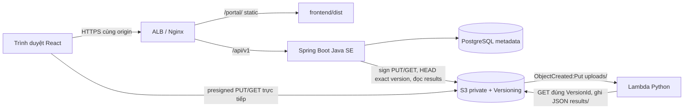

# Bàn giao triển khai AWS cho Chiến

Ngày 10/11/2026. Bản nguồn: `dung@d0d8141ee037e14bc154237385d6f971689cf0b3`,
[PR #3](https://github.com/Chien2k5/cloud-document-handover/pull/3) đã merge với đủ
6 checkpoint. **Tài liệu là runbook đề xuất để Chiến/nhóm review và thực hiện;
không có tài nguyên AWS nào được triển khai/thay đổi trong nhiệm vụ này.**
AWS E2E, HTTPS/Beanstalk, restore Cloud, CloudWatch/chi phí: **NOT_RUN**.

## 1. Kiến trúc và phạm vi bản bàn giao



Node chỉ cần ở bước build, không cần chạy Node server trong môi trường Java SE.
Backend không nhận bytes file để proxy sang S3; Lambda không gọi ngược backend.
Backend đọc JSON khi client gọi API trạng thái rồi quyết định VERIFIED/MISMATCH.
Nextcloud local cổng 8081 là môi trường riêng, chưa có adapter/đồng bộ vào luồng này.
Không dùng DB hoặc volume Nextcloud làm PostgreSQL portal.

## 2. Phiên bản, build và bằng chứng local

| Thành phần | Nguồn/phiên bản |
| --- | --- |
| Backend | Spring Boot 3.5.16; Java target/release 21; local đã kiểm JDK 25 |
| Runtime AWS đề xuất | Java SE Corretto 21 trên AL2023, chọn platform còn được hỗ trợ trong region thực tế |
| Build | Maven Wrapper 3.9.12, Node 24.15.0/npm 11.12.1 đã kiểm; package engines Node >=22.12 |
| Frontend | React 19.3.1, Vite 8.3.7, lockfile được commit |
| Database | PostgreSQL 17 đã kiểm; chọn engine/minor RDS tương thích và CA/TLS thực tế |
| Lambda | `aws/lambda/lambda_function.py`, handler `lambda_function.lambda_handler`; đề xuất Python 3.12, xác nhận runtime/SDK trước deploy |

Chiến đối chiếu [platform hiện được AWS hỗ trợ](https://docs.aws.amazon.com/elasticbeanstalk/latest/platforms/platforms-supported.html)
trước khi tạo môi trường; tài liệu này không cố định một platform release/AMI đã lỗi thời.

Build từ nguồn sạch đã checkout đúng SHA:

```powershell
cd backend
.\mvnw.cmd -B -ntp clean verify
cd ..\frontend
npm ci
npm run lint
npm test
npm run test:e2e
npm run build -- --base=/portal/
```

Lệnh build base `/portal/` đã được kiểm local và index trỏ `/portal/assets/`.
Điều này không xác nhận cấu hình Nginx/Beanstalk hoặc HTTPS trên AWS đã chạy.

Maven mặc định có thể SKIP integration tests nếu thiếu RUN_DB_TESTS; không dùng
build đó để ghi PostgreSQL PASS. Bộ kiểm thực hiện trong release này dùng runner:

```powershell
cd frontend
python tools/run_live_check.py
```

Runner tự tạo PostgreSQL container/DB mới, chạy 62 backend tests, build JAR và 3
browser LIVE API; xóa DB thử/dừng JAR trong finally. Cần Docker/JDK/Chrome/npm và
Maven cache hoặc Maven Central. Không chạy test TRUNCATE lên RDS hay DB chung.

Trước và sau merge đã đạt: 17 unit frontend, 17 browser MOCK, 62 backend DB thật
(storage MOCK), 3 browser LIVE auth/project/membership/503 fail closed, 25 Python
MOCK và 12 ca Java/Python contract. Không có CI check-run trên GitHub tại audit;
không gọi trạng thái đó là CI PASS. [Audit release](../contributions/contribution-audit.md)
ghi SHA và phạm vi. Các kết quả local không thay AWS E2E.

## 3. Biến môi trường và tài khoản

Spring Boot/Lambda không tự đọc `.env`. Các biến frontend `VITE_*` có thể lọt vào
bundle; không đưa credential/secret vào đó. `API_PROXY_TARGET` chỉ cho Vite dev,
production client dùng `/api/v1` cùng origin.

| Biến | Nơi dùng | Giá trị/điều kiện trên AWS |
| --- | --- | --- |
| DB_URL | Backend | JDBC PostgreSQL tới DB portal private, TLS verify-full và CA đúng môi trường |
| DB_USERNAME / DB_PASSWORD | Backend | Role DB riêng; secret được cấp ngoài Git, không dùng PostgreSQL superuser |
| SERVER_PORT | Backend | `5000` trong bundle Java SE đề xuất |
| PORT | Beanstalk proxy | `5000`, phải khớp SERVER_PORT vì app hiện không tự đọc PORT |
| SPRING_PROFILES_ACTIVE | Backend | Không đặt `local`; source không có profile prod riêng bắt buộc |
| SESSION_COOKIE_SECURE | Backend | `true` (mặc định ngoài local) |
| LOCAL_DEMO_PASSWORD | Backend | Bỏ trống/không đặt trên AWS; không bật local demo seed |
| UPLOAD_S3_ENABLED | Backend | `true` sau khi bucket/role/Lambda đã cấu hình |
| UPLOAD_BUCKET | Backend và Lambda | Cùng chính xác tên bucket Versioning Enabled |
| AWS_REGION | Backend | Region thật của bucket; Lambda/bucket cùng region |
| UPLOAD_TTL_SECONDS | Backend | Mặc định 300; hợp lệ 1..300 |
| UPLOAD_EXPIRY_DELAY_MS | Backend | Mặc định 30000 |
| PROJECT_QUOTA_BYTES | Backend | Mặc định 1073741824; nhóm xác nhận giới hạn phù hợp |
| AWS credentials | SDK/roles | EC2 instance profile và Lambda execution role; không nhúng access key vào frontend/Git |

Secrets Manager/SSM/secret injection của môi trường do Chiến thiết lập. App hiện đọc
biến môi trường, không có code tự gọi Secrets Manager. Dũng phối hợp provisioning
tài khoản portal enabled; chưa có registration/reset password/user-directory API.
Không dùng tài khoản Nextcloud để đăng nhập portal, không dùng seed local để tạo user Cloud.

## 4. Quy trình deploy Java SE và frontend cùng origin

1. Chiến tạo môi trường lab/staging, kiểm tra budget/quyền/region trước khi cấp
   tài nguyên. RDS/DB portal độc lập vòng đời EB, private network; security group
   chỉ cho app truy cập DB. Flyway chạy migration hiện có; không clean/baseline để che lỗi.
2. Chọn Java SE runtime tương thích bytecode 21. Cấu hình role, env, log và health
   check `/api/v1/health` (endpoint công khai kiểm DB; không chứng minh S3 đã hoạt động).
3. Chuẩn bị staging bundle dưới đây. Đổi tên JAR đã build thành `app.jar`; frontend
   chỉ gồm dist đã build với base `/portal/`, không gồm node_modules/.env/source secret.
4. Tạo application version từ ZIP staging, deploy vào lab/staging rồi kiểm health,
   log, frontend assets và API. Nhiệm vụ hiện tại không thực hiện lệnh deploy.

```text
app.jar
Procfile
frontend/dist/index.html
frontend/dist/assets/...
.platform/nginx/conf.d/elasticbeanstalk/99_portal.conf
```

Procfile (UTF-8/LF):

```text
web: java -jar app.jar
```

Với PORT/SERVER_PORT cùng 5000, Nginx mặc định của EB chuyển API tới app. Dùng
`99_portal.conf` **để nhóm review** trong server block:

```nginx
location = / {
    return 302 /portal/;
}
location /portal/ {
    alias /var/app/current/frontend/dist/;
    index index.html;
}
```

App hiện không dùng client router nên không cần fallback cho route sâu dưới portal.
Prefix `/portal/` tránh khai báo trùng `location /` của proxy mặc định. Cách include
server extension và port dựa trên [AWS reverse proxy configuration](https://docs.aws.amazon.com/elasticbeanstalk/latest/dg/platforms-linux-extend.proxy.html).
Chiến cần chạy kiểm tra Nginx/asset path trên platform chọn; snippet chưa được kiểm
trên EB. Không dùng cấu hình `.ebextensions/nginx` cũ của AL1 cho AL2023.

Từ thư mục staging chỉ chứa artefact nêu trên, có thể đóng gói cả dot-folder bằng:

```powershell
python -m zipfile -c eb-release.zip app.jar Procfile frontend .platform
```

ZIP phải có các mục ở root, không bọc thêm thư mục cha. Gói do
`backend/tools/build_handover_bundle.py` tạo là gói source bàn giao, không thay
bundle Java SE này. Chưa có CI/CD hoặc artefact EB được tự triển khai trong release.

## 5. HTTPS, session và CSRF

Chiến cấu hình hostname/chứng chỉ TLS, HTTPS listener và chuyển HTTP sang HTTPS;
frontend `/portal/` và `/api/v1` phải cùng origin. Static phải do proxy phục vụ,
không gửi tới Spring Security như API. Kiểm tra scheme/host và trusted forwarding
headers của ALB/Nginx; không vô hiệu Secure cookie để chữa lỗi proxy trên AWS.

Backend hiện dùng HttpSession/Tomcat memory, cookie HttpOnly/Secure/SameSite=Lax,
timeout 30 phút. Không JWT, không shared session store. Cho lab có thể giữ một app
instance; nếu nhiều target cần kế hoạch session affinity/shared sessions và kiểm
đăng nhập qua deploy/restart. Sticky session không làm session sống qua mất instance.
Xem [ALB target stickiness](https://docs.aws.amazon.com/elasticloadbalancing/latest/application/edit-target-group-attributes.html).

Client lấy `/auth/csrf`, dùng headerName server trả về, login form email/password,
lấy CSRF mới sau login/logout và giữ cookie cùng origin. Không gửi cookie/CSRF
sang S3. Đăng nhập lại sau session hết hạn/restart là hành vi cần kiểm thử;
không retry request ghi mù khi timeout/403.

## 6. S3 private, Versioning, IAM và CORS

Chiến/Đăng kiểm Block Public Access, policy không public, mã hóa, Versioning
**Enabled**, region, roles và hạn URL. Không coi Signed URL là chứng minh role đủ
quyền; phải PUT/HEAD/GET thật. Không cấp quyền delete cho upload signer để mở lại key
trong thời gian URL còn sống. Cleanup/orphan/lifecycle cần chính sách riêng bảo vệ
các version đã hoàn tất hoặc nằm trong gói.

| Principal | Quyền S3 cần đối chiếu |
| --- | --- |
| Backend instance role | PutObject và GetObjectVersion trên `uploads/*`; GetObject trên `results/*`; ListBucket trên bucket để phân biệt missing result với denied theo hành vi S3 |
| Lambda execution role | GetObjectVersion trên `uploads/*`; PutObject/GetObject trên `results/*`; quyền CloudWatch Logs |
| Backup/restore role | Tách riêng khỏi portal, chỉ prefix/bucket backup cần thiết; quyền đọc restore riêng |

GET có Version ID cần `s3:GetObjectVersion`. Thiếu `ListBucket`, object không tồn tại
có thể trả 403 thay vì 404; backend không được biến 403 thành chờ. Chiến review
resource ARN/prefix thực tế, SCP/bucket policy và quyền KMS nếu dùng SSE-KMS;
không thêm `s3:*`/`kms:*` để chữa lỗi. [AWS GetObject](https://docs.aws.amazon.com/AmazonS3/latest/API/API_GetObject.html).

CORS mẫu trong S3 Console, thay origin bằng hostname frontend thật, không tự áp dụng:

```json
[
  {
    "AllowedOrigins": ["https://portal.example.invalid"],
    "AllowedMethods": ["PUT", "GET", "HEAD"],
    "AllowedHeaders": ["content-type", "if-none-match"],
    "ExposeHeaders": ["x-amz-version-id"],
    "MaxAgeSeconds": 300
  }
]
```

Browser phải gửi nguyên mọi signed header; nếu signer thêm header, cập nhật rule
theo request thực tế. ExposeHeaders cho phép JS đọc Version ID; CORS không cấp
IAM và không làm bucket public. [AWS CORS elements](https://docs.aws.amazon.com/AmazonS3/latest/userguide/ManageCorsUsing.html).

## 7. Lambda và checksum đúng phiên bản

Đăng đóng ZIP chỉ có `lambda_function.py` ở root từ `aws/lambda/`, không đóng test.
Giữ handler và UPLOAD_BUCKET. Execution role truy cập S3/log; resource policy
cho `s3.amazonaws.com` invoke function, ràng buộc SourceArn và SourceAccount.
Trigger bucket cùng region, `s3:ObjectCreated:Put`, prefix **uploads/**; tuyệt đối
không trigger results/. [AWS Lambda với S3](https://docs.aws.amazon.com/lambda/latest/dg/with-s3.html).

Lambda đọc đúng event VersionId, decode key đúng một lần; không trim/encode lại
Version ID. Đặt timeout/memory rồi đo với file nhỏ và biên 100 MiB. SDK timeout
không phải tổng deadline Lambda. Kiểm retry/destination lỗi để sự kiện thất bại có
dấu vết; không chuyển lỗi hạ tầng thành hash thành công.

Luồng contract trong source hiện hành:

1. Browser tính SHA-256, init với filename/contentType/size/expectedSha256 (fileId
   chỉ khi thêm version), PUT có signed Content-Type và If-None-Match `*`.
2. Lấy `x-amz-version-id` từ response PUT, complete chỉ `{versionId}`. Mất ID:
   không dùng ETag/latest/uploadId/fileVersionId thay thế, chờ expiry/tạo upload mới.
3. Lambda GET exact version, ghi 9 field schema v1 tại
   `results/{sha256(bucket UTF8)}/{sha256(objectKey UTF8)}/{sha256(versionId UTF8)}.json`.
4. Conditional result PUT; 412 phải kiểm JSON cũ khớp trước khi skip, 409/5xx/timeouts
   propagate. Stream phải đóng, size/version thật được kiểm tra.
5. Backend HEAD đúng version trước AVAILABLE; state API đọc result, kiểm schema/
   identity/size rồi so expected/actual: VERIFIED hoặc MISMATCH. Thiếu JSON giữ chờ,
   JSON hỏng/Lambda FAILED thành integrity FAILED; lỗi IAM/network là 503.
6. AVAILABLE không đồng nghĩa VERIFIED. DRAFT chỉ chọn AVAILABLE+VERIFIED; publish
   kiểm lại HEAD. File v2 không thay pin v1 trong gói. Download luôn exact version.

Nguồn: [OpenAPI](../../contracts/openapi.yaml), [schema](../../contracts/checksum-result.schema.json),
[adapter contract](../../contracts/s3-adapter-contract.md), [Lambda README](../../aws/README.md).
Các ghi chú trước 09/11 nói Lambda chưa khớp là lịch sử; bản sửa hiện tại là `629b364`.
Python presigner POC không thay Java adapter đang được backend gọi.

## 8. Backup/restore và bảo vệ dữ liệu

Chiến chuẩn bị backup PostgreSQL vào bucket backup tách quyền, mã hóa, retention
và quy trình restore vào DB đích riêng. Dũng kiểm metadata/migration/audit; Đăng
kiểm các bucket/key/Version ID còn truy xuất được. DB restore không khôi phục
object version đã bị lifecycle/delete trên S3. Không xóa pinned version để giả revoke.

Có thể dùng pg_dump custom archive và pg_restore; cấu hình PGHOST/PGPORT/PGUSER/
PGDATABASE/TLS qua môi trường an toàn, không đưa password vào lệnh/Git. Ví dụ do
Chiến điều chỉnh theo DB và role đã kiểm tra, chưa chạy ở đây:

```text
pg_dump --format=custom --no-owner --no-acl --file portal.dump
pg_restore --no-owner --no-acl --dbname <restore_database_rieng> portal.dump
```

Kết nối backup và restore phải được chọn riêng, đích mới/trống được xác nhận trước.
Giữ dump ngoài repo vì có dữ liệu và password hashes. Không chạy restore ghi đè
DB production hoặc test TRUNCATE lên RDS. [PostgreSQL SQL dump](https://www.postgresql.org/docs/17/backup-dump.html).

Chạy lại health/login/project/file/gói trên app trỏ DB restore riêng, xác minh
đúng S3 version/hash và quyền; ghi thời điểm backup, mục tiêu phục hồi, thực tế
mất dữ liệu/thời gian và version source. Không bịa RPO/RTO nếu chưa đo.
`backend/tools/run_local_restore_check.py` và evidence week-04/05 là kiểm tra local,
không tự dùng nguyên script local như runbook production/RDS đã nghiệm thu.

## 9. Monitoring, log, chi phí và rollback

Chiến cấu hình EB health/log stream, CloudWatch Logs Lambda (retention/quyền),
alarm theo lỗi 5xx, Lambda Errors/Throttles/Duration, DB connection/storage và
budget theo tài nguyên thực tế. Health 200 chỉ kiểm DB, không thay kiểm S3/Lambda.
Dũng cung cấp mã lỗi/requestId và audit_events; Đăng đối chiếu event/version/result.
Không có audit API UI mới được tự phát minh trong bản này.

Không log cookie/password/CSRF, body credentials hoặc presigned URL còn hạn.
Giới hạn quyền đọc log; chỉ chia sẻ evidence đã khử secret. Lưu commit/application
version/role/bucket/region và cấu hình không secret để tái lập; không chụp màn hình key.
Chiến ghi chi phí từ tài khoản thực tế, không lấy một con số dự toán thành chi phí đã dùng.

Rollback code bằng EB application version đã lưu; schema V1 không đổi qua PR #3.
Không tự rollback/restore DB đang có dữ liệu mới. Kiểm sự tương thích schema trước
khi rollback; việc restart/deploy có thể mất session memory. Giữ các S3 version
nghiệp vụ và lịch sử audit; không force push/viết lại Git để rollback.

## 10. Checklist nghiệm thu AWS — tất cả hiện NOT_RUN

| # | Ca kiểm | Điều kiện đạt / evidence | Người phụ trách phối hợp | Trạng thái |
| --- | --- | --- | --- | --- |
| 1 | Login | HTTPS, cookie Secure/HttpOnly, CSRF rotation, sai password/expired session đúng lỗi | Chiến cấu hình; Dũng API; Nam UI | NOT_RUN |
| 2 | Tạo project | Owner/member roles, cách ly project, quota/reservation; 403/404 đúng | Dũng, Nam | NOT_RUN |
| 3 | Upload S3 thật | Signed headers, PUT thành công, Version ID non-null; thiếu/sửa header bị từ chối | Đăng, Nam, Chiến | NOT_RUN |
| 4 | Lambda chạy | Đúng uploads/ event/version, JSON results/, không vòng lặp, event lặp/trễ đúng | Đăng; Chiến role/log | NOT_RUN |
| 5 | VERIFIED/MISMATCH | Poll backend xác minh đúng tuple/hash; ca API đối kháng expected hash sai phải MISMATCH, không tải/bàn giao được | Dũng, Đăng, Nam | NOT_RUN |
| 6 | Tạo DRAFT | Đủ title/recipients/hạn timezone; chỉ AVAILABLE+VERIFIED, Owner mới tạo | Nam, Dũng | NOT_RUN |
| 7 | Publish | DRAFT → READY, exact HEAD, role/hạn/current state đều được kiểm | Dũng, Nam, Đăng | NOT_RUN |
| 8 | Confirm | Đúng người nhận; 1/2 xác nhận chưa tự thành toàn gói CONFIRMED; outsider bị từ chối | Dũng, Nam | NOT_RUN |
| 9 | Download đúng version | Hash file tải xuống đúng v1 dù đã upload v2; URL có Version ID và TTL phù hợp | Đăng, Dũng, Nam | NOT_RUN |
| 10 | Revoke/expiry | Không cấp URL mới, không xóa dữ liệu để giả revoke; đo hành vi URL cũ theo TTL | Dũng, Nam; Chiến cấu hình | NOT_RUN |
| 11 | Backup/restore | S3 backup → DB mới → truy xuất đúng project/file/gói/audit và exact S3 hash/version | Chiến; Dũng/Đăng xác minh; Nam UI | NOT_RUN |
| 12 | HTTPS/IAM/log/chi phí | Health, TLS, least privilege, CORS, lỗi IAM phân biệt missing, alarms/retention/budget và cleanup có kiểm soát | Chiến chủ trì, từng chủ module phối hợp | NOT_RUN |

Không thêm ô nhập hash sai vào UI production để thử MISMATCH. Dùng client test
được xác thực/session/CSRF trên project thử: init với expected hash sai nhưng size/type
đúng, PUT bytes gốc, complete Version ID thật, kiểm trạng thái/chặn download.
Không đổi backend/Lambda để test qua. Với file lớn/orphan, quota hiện là quota logic,
chưa chứng minh hard quota byte vật lý S3; cleanup và giới hạn chi phí còn phải chốt.

## 11. Phân loại lỗi và bàn giao trách nhiệm

| Dấu hiệu | Đầu mối sửa | Người phối hợp / bằng chứng cần có |
| --- | --- | --- |
| EB không start, proxy/TLS/SG/DB network sai | Chiến | Dũng kiểm cấu hình app/stacktrace đã khử secret |
| Session/CSRF/role/project/migration/transaction sai dù infra đúng | Dũng | Nam tái hiện UI; Chiến cung cấp requestId/log môi trường |
| UI gửi sai payload/header, bỏ Version ID, hiển thị sai trạng thái | Nam theo phân công, Dũng phối hợp bản tích hợp | Repro browser + API contract; người thực hiện sửa được ghi nhận bằng commit |
| Lambda/JSON/result key/version/duplicate/timeout logic sai | Đăng | Dũng đối chiếu contract Java; Chiến cung cấp event/log/quyền |
| IAM/CORS/Versioning/notification/KMS sai | Chiến và Đăng | Nam kiểm browser headers; Dũng kiểm phân loại 403/404/503 |
| Restore DB/quyền backup/cost/log retention | Chiến | Dũng kiểm schema/data/audit; Đăng xác minh object versions; Nam thử UI |

Chiến điều phối triển khai, không mặc định chịu sửa toàn bộ code backend/frontend/
Lambda. Mỗi lỗi cần nguồn SHA, bước tái hiện, mong đợi/thực tế, mã lỗi và evidence
không secret. Nhóm xác nhận người nhận việc và hạn; không tự ghi thành viên đã đồng ý
hay đã nghiệm thu khi chưa có xác nhận.
